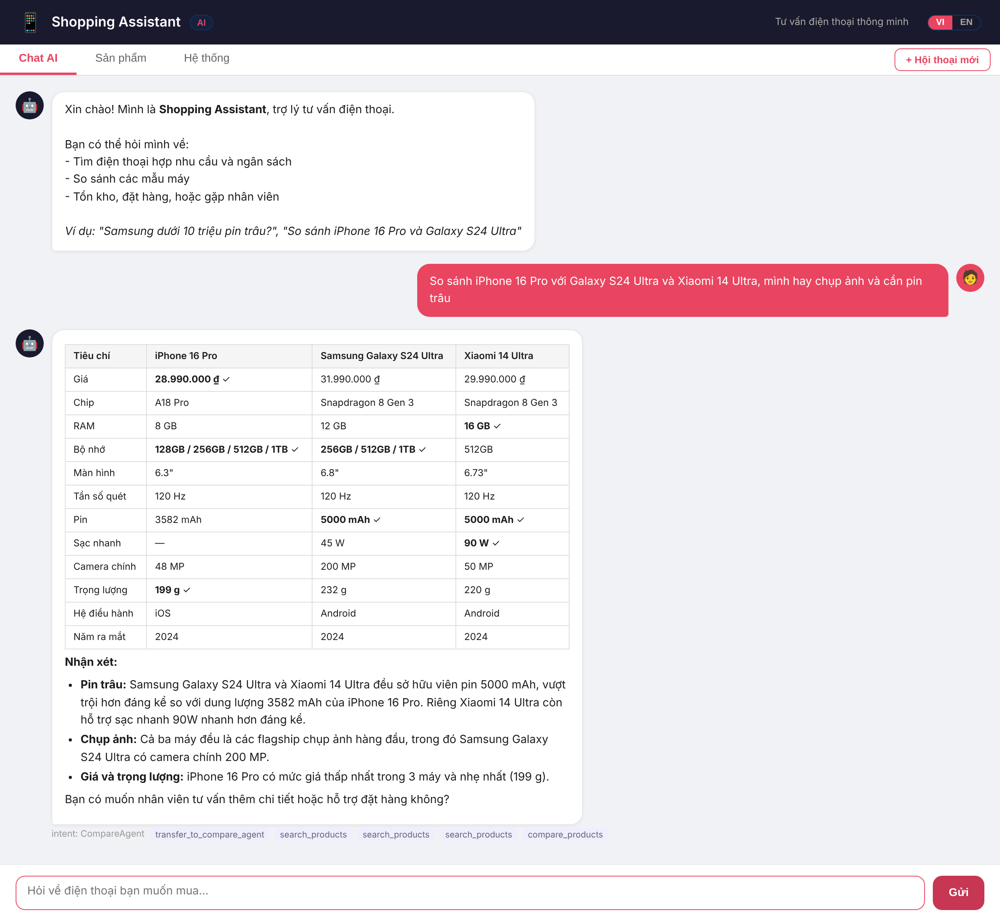
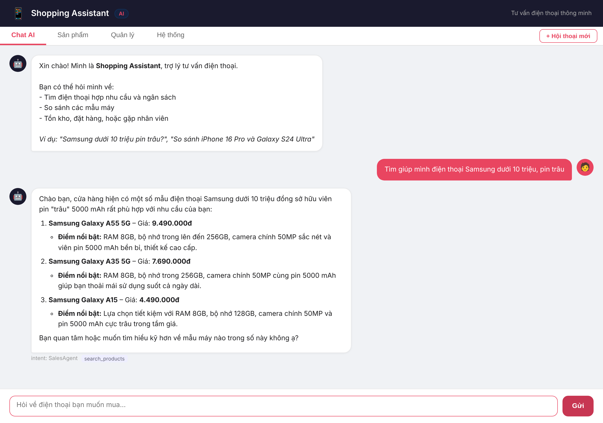
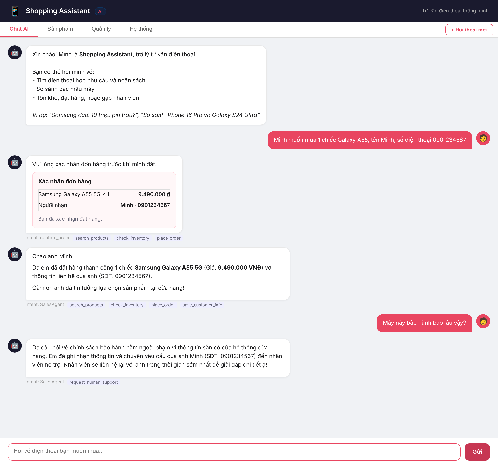
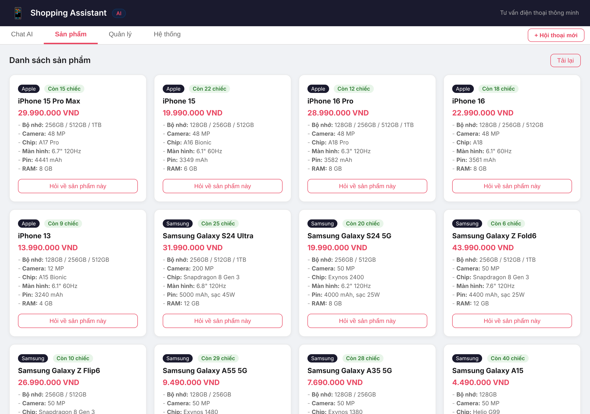
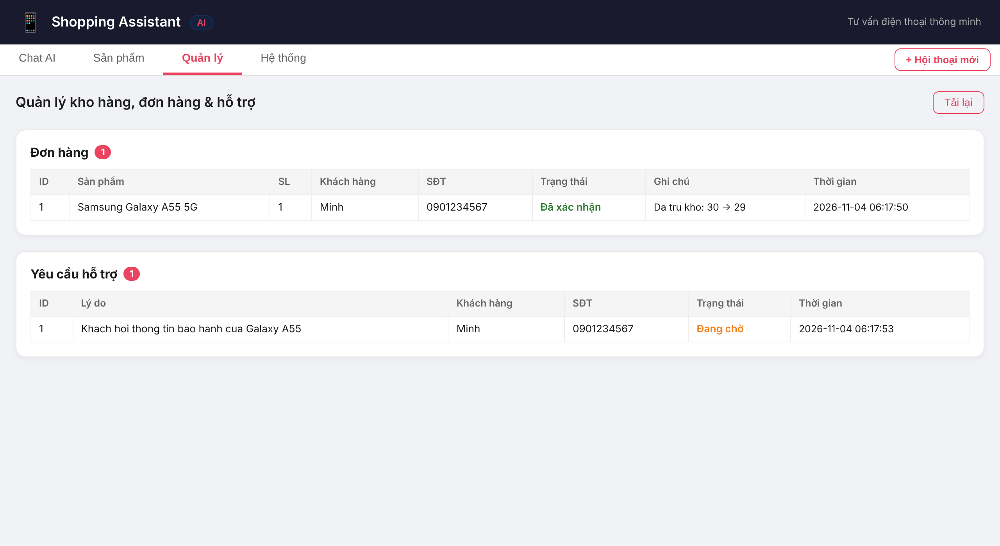
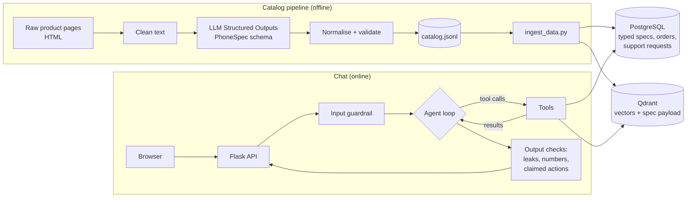

# Shopping Assistant Agent

A Vietnamese phone-shopping chatbot built directly on **LLM function calling**, with no agent framework. Two agents hand off to each other to search, compare, check stock, place orders and escalate to staff. The product catalog is built by an **LLM structured-extraction pipeline**, and comparisons are computed in code, so the bot cannot misread or invent specs.

Works with any OpenAI-compatible provider. Tested with OpenAI and with Google Gemini's free tier.



## Highlights

| | |
| --- | --- |
| **99.5% field accuracy** | The extraction pipeline turns raw product pages into typed specs. It scores 418/420 fields on 30 hand-labelled pages ([report](docs/extraction_eval.md)). |
| **Comparisons without made-up numbers** | `compare_products` builds the table and per-aspect winners from PostgreSQL. The agent loop rejects answers that contain numbers missing from the tool output. |
| **Structured search** | "Samsung under 10 million with a big battery" becomes `brand=Samsung, price_max=10000000, battery_min=5000`, then semantic ranking in Qdrant. |
| **No overselling** | Orders run in one transaction with `SELECT … FOR UPDATE`. In a test where 8 buyers race for the last unit, exactly 1 order is confirmed (without the lock, 5 were). |
| **Actions are verified** | If an answer claims "your order is placed" or "staff will call you" and the matching tool was not called, the agent is asked to redo the turn. |
| **One-command setup** | Docker Compose runs the app, PostgreSQL and Qdrant together. |

## Screenshots

| Filtered search | Order, then an out-of-scope question goes to staff |
| --- | --- |
|  |  |

| Catalog (typed specs) | Staff view: orders and support requests |
| --- | --- |
|  |  |

## Architecture



### Agents and tools

`SalesAgent` handles search, stock and orders. `CompareAgent` handles comparisons. They transfer the conversation to each other with handoff tools, and each has its own system prompt and tool set.

| Tool | Sales | Compare | What it does |
| --- | :---: | :---: | --- |
| `search_products` | ✓ | ✓ | Filter by brand, OS, price, RAM, battery and storage, then rank by meaning |
| `get_product_details` | ✓ | ✓ | Full typed spec sheet for one product |
| `compare_products` | | ✓ | 2–4 products: Markdown table plus per-aspect winners, computed in code |
| `check_inventory` | ✓ | | Stock level and status |
| `place_order` | ✓ | | Locks the row, deducts stock, or creates a pending-restock order |
| `save_customer_info` | ✓ | ✓ | Attaches name and phone to a pending order or support request |
| `request_human_support` | ✓ | ✓ | Opens a ticket for staff (warranty, returns, payment…) |
| `transfer_to_compare_agent` / `transfer_to_sales_agent` | ✓ / | / ✓ | Handoffs |

## How it works

### 1. Catalog from structured extraction

[`app/catalog.py`](app/catalog.py) defines `PhoneSpec`, a Pydantic model with 14 typed fields (price in VND, chipset, RAM, storage options, screen, refresh rate, battery, charging, main camera, weight, OS, release year). [`scripts/extract_catalog.py`](scripts/extract_catalog.py) does the following for each product page:

1. strips the HTML to readable text (table cells kept as `label | value`),
2. asks the LLM for a `PhoneSpec` with a strict JSON schema (Structured Outputs),
3. normalises it (brand names, `Qualcomm Snapdragon … for Galaxy` → `Snapdragon …`, `1TB` → `1024`),
4. validates value ranges and rejects impossible records,
5. writes `data/catalog.jsonl`, which is committed so the app runs without calling the LLM again.

The 30 sample pages in [`data/raw_pages/`](data/raw_pages/) are written to be tricky on purpose: list price next to the sale price, instalment amounts, gifts and trade-in offers, `6,7 inch`, `5.000 mAh`, `28,99 triệu`, and missing fields that must come back as `null`. [`scripts/eval_extraction.py`](scripts/eval_extraction.py) compares the result with hand-labelled answers in [`data/gold_specs.json`](data/gold_specs.json):

| Model | Field accuracy | Pages fully correct |
| --- | ---: | ---: |
| `gemini-3.5-flash-lite` | 418/420 = **99.5%** | 28/30 |

Both errors kept a "5G" suffix in the model name. The sample pages are cleaner than real retail pages, so expect lower accuracy on crawled data.

### 2. Search with filters

Specs are stored as typed columns in PostgreSQL and as payload in Qdrant. The tool schema tells the model how to turn needs into filters ("under 10 million" → `price_max`, "big battery" → `battery_min=5000`). Anything that cannot be filtered ("good night photos") stays in the semantic query. When nothing matches the filters, the tool says so and returns the nearest matches separately. It never drops the filters silently.

### 3. Comparisons computed in code

[`app/services/compare.py`](app/services/compare.py) reads the products from PostgreSQL and builds the table. Each aspect knows whether higher or lower is better (price and weight: lower; battery, RAM, charging: higher). Camera megapixels, chip and screen size are shown but not scored. The agent must copy the table as is and comment only on it. After the answer, `unsupported_numbers` checks that every number in the reply appears in the tool output. Prices like `22,99 triệu` and `22.990.000 ₫` count as the same number. On a mismatch the agent rewrites once; if it still fails, the response carries a warning.

### 4. Orders that cannot oversell

`place_order` and `update_stock` run inside `engine.begin()` and lock the product row with `SELECT … FOR UPDATE`, so concurrent orders queue up instead of reading the same stock. [`tests/test_place_order.py`](tests/test_place_order.py) races 8 threads for the last unit, five rounds in a row. One shared SQLAlchemy engine with a connection pool replaces the old `create_engine()` per call.

### 5. Guardrails

- **Input:** length limit and prompt-injection patterns.
- **Output:** blocks leaked internals (system prompt, vector-store details, API keys).
- **Claimed actions:** "đơn hàng đã được ghi nhận" without `place_order`, or "nhân viên sẽ liên hệ" without `request_human_support`, sends the agent back to actually do it. This was added after a test conversation where the bot promised a callback but never opened a ticket.
- The server injects the real `session_id` into support tools, so the model never has to guess it.

## Tech stack

| Area | Technology |
| --- | --- |
| LLM and tool calling | Any OpenAI-compatible Chat Completions API (OpenAI `gpt-4.1-mini`, Gemini `gemini-3.5-flash-lite`) |
| Structured extraction | Structured Outputs with a Pydantic schema |
| Embeddings | `text-embedding-3-small` or `gemini-embedding-001` |
| Vector database | Qdrant (local file mode, or server in Docker) |
| Relational database | PostgreSQL 16, SQLAlchemy 2 |
| Backend | Flask, gunicorn |
| Frontend | HTML, CSS, JavaScript, marked.js |
| Tests | pytest (concurrency test against a real PostgreSQL) |
| Deployment | Docker Compose |

## Getting started

### Option A: Docker (recommended)

```bash
git clone https://github.com/duyle215/shopping-assistant-agent.git
cd shopping-assistant-agent
cp .env.example .env    # set the LLM key and POSTGRES_PASSWORD
docker compose up -d --build
docker compose run --rm app python scripts/ingest_data.py
```

Open http://localhost:5000.

### Option B: Run locally

Requirements: Python 3.10+, PostgreSQL 14+, and an OpenAI or Gemini API key.

```bash
python -m venv .venv
.venv\Scripts\activate            # Windows
# source .venv/bin/activate       # Linux / macOS
pip install -r requirements.txt
cp .env.example .env              # then edit it
```

Create the database (`CREATE DATABASE shopping_assistant;`), then:

```bash
python scripts/check_health.py    # expects: Postgres OK, Qdrant OK
python scripts/ingest_data.py     # loads data/catalog.jsonl into PostgreSQL and Qdrant
python run.py                     # http://localhost:5000
```

Qdrant in local file mode allows only one process, so stop `run.py` before running `ingest_data.py` again, or use a Qdrant server via `QDRANT_URL`.

### Choosing a provider

`.env.example` has both options. For Gemini:

```ini
OPENAI_BASE_URL=https://generativelanguage.googleapis.com/v1beta/openai/
OPENAI_API_KEY=your_gemini_api_key
LLM_MODEL=gemini-3.5-flash-lite
EMBED_MODEL=gemini-embedding-001
EMBED_DIM=3072
```

After changing `EMBED_MODEL` or `EMBED_DIM`, run `scripts/ingest_data.py` again. On a free tier, set `EXTRACT_MODEL` to a different model than `LLM_MODEL` so catalog extraction does not use up the chatbot's daily quota (limits are per model).

## Scripts

| Script | Purpose |
| --- | --- |
| `scripts/check_health.py` | Check PostgreSQL and Qdrant connections |
| `scripts/extract_catalog.py` | Product pages → `PhoneSpec` → `data/catalog.jsonl` (`--only`, `--max-pages`, retries on rate limits) |
| `scripts/eval_extraction.py` | Per-field accuracy against `data/gold_specs.json`, writes `docs/extraction_eval.md` |
| `scripts/ingest_data.py` | Load one or more catalog files into PostgreSQL and Qdrant |
| `scripts/crawl_pages.py` | Slow, polite crawler for real product pages (see below) |

### Crawling real pages

`crawl_pages.py` reads each site's `robots.txt` and skips disallowed URLs, waits at least 5 seconds (or the site's `Crawl-delay`) between requests, stops after `--max-pages`, and resumes where it left off. Pages go to `data/crawled/`, which is git-ignored. Do not commit other sites' content, and read each site's terms before crawling.

```bash
cp data/crawl_urls.example.txt data/crawl_urls.txt    # add product page URLs
python scripts/crawl_pages.py --urls data/crawl_urls.txt --max-pages 50
python scripts/extract_catalog.py --pages data/crawled --out data/catalog_crawled.jsonl --max-pages 50
python scripts/ingest_data.py --catalog data/catalog.jsonl data/catalog_crawled.jsonl
```

## API

| Method | Endpoint | Description |
| --- | --- | --- |
| GET | `/` | Chat UI |
| POST | `/api/chat` | `{"message": "...", "session_id": "..."}` → answer, agent, tools called, warning |
| GET | `/api/products` | Catalog with typed specs |
| GET / PATCH | `/api/stock` | Stock levels / update one product's stock |
| GET | `/api/orders` | Orders |
| GET | `/api/support-requests` | Support requests for staff |
| POST | `/api/session/clear` | Clear a conversation |
| GET | `/api/health` | PostgreSQL and Qdrant status |

## Tests

```bash
pip install -r requirements-dev.txt
pytest
```

Tests use a separate database (`shopping_assistant_test`, created automatically) and skip if PostgreSQL is not running. They cover order placement and the concurrency race, HTML cleaning, normalisation and validation, the comparison table, the number check, and guardrails.

## Project structure

```
.
├── run.py                      # Entry point
├── app/
│   ├── config.py               # Settings from .env
│   ├── db.py                   # Shared PostgreSQL engine and Qdrant client
│   ├── models.py               # Tables (products with typed specs, orders, support requests)
│   ├── catalog.py              # PhoneSpec schema, HTML cleaning, normalisation, validation
│   ├── guardrails.py           # Input, output and claimed-action checks
│   ├── sessions.py             # In-memory chat history (20 turns, 1 h)
│   ├── routes.py               # REST API and UI
│   ├── agent/
│   │   ├── core.py             # Agent loop, handoffs, answer checks
│   │   ├── tools.py            # Tool schemas and dispatch
│   │   ├── prompts.py          # System prompts and per-agent tool sets
│   │   └── schemas.py          # Pydantic models
│   └── services/
│       ├── search.py           # Filtered semantic search
│       ├── compare.py          # Comparison table and number check
│       ├── product.py          # Product queries
│       ├── inventory.py        # Stock and orders (row locks)
│       └── support.py          # Human support requests
├── scripts/                    # Extraction, evaluation, ingestion, crawling, health check
├── data/
│   ├── raw_pages/              # 30 sample product pages (HTML)
│   ├── gold_specs.json         # Hand-labelled answers for evaluation
│   ├── catalog.jsonl           # Extracted catalog (loaded by ingest_data.py)
│   └── stock.json              # Starting stock per product
├── docs/                       # Extraction report and screenshots
├── tests/
├── templates/index.html        # Single-page UI
├── Dockerfile
└── docker-compose.yml
```

## Roadmap

**Done**
- [x] Row locks and a shared connection pool for orders; concurrency test
- [x] `PhoneSpec` schema, typed product table, extraction pipeline with validation
- [x] Hand-labelled set of 30 pages and per-field accuracy report
- [x] Search with structured filters
- [x] `compare_products` computed in code, plus a check on numbers in the answer
- [x] Check that claimed actions were really performed
- [x] Polite crawler for real product pages
- [x] Docker Compose

**Next**
- [ ] Grow the catalog to 200–500 phones from crawled pages or a public spec dataset, and measure extraction accuracy on real pages
- [ ] Move orchestration to LangGraph: graph edges for handoffs, state saved in PostgreSQL, **confirmation step before `place_order`**, streamed answers
- [ ] Hybrid search (keyword + semantic)
- [ ] Evaluation suite: 40–50 scripted conversations (expected tools, arguments, handoffs), rule checks plus an LLM judge, a prompt-injection set, run in CI
- [ ] Tracing (tools, tokens, latency, cost per turn)
- [ ] LLM-based intent and injection classifier on top of the regex layer

## Known limitations

- The 30 sample pages and their prices are written for this demo. Check real prices and specs before relying on them.
- Chat history lives in memory, so it resets when the server restarts and the app runs as a single process.
- The model can still add details from its own knowledge in free-text answers (for example, a feature that is not in the catalog). Comparisons are protected by the number check; general answers will be covered by the planned evaluation suite.

## License

GPL-3.0. See [LICENSE](LICENSE).
