# Shopping Assistant Agent

A bilingual (Vietnamese / English) phone-shopping assistant built on **LangGraph** and integrated with **Odoo 19 Community**. Products, stock, sales orders and support requests live in Odoo; the chatbot reads and writes them through Odoo's JSON-2 API with its own API user, and appears as a floating chat window on the Odoo website. Two agents hand off to each other to search, compare, check stock, take orders and escalate to staff. Orders wait for the customer's confirmation, then become confirmed sales orders that reserve stock in Odoo. Comparisons are computed in code, so the bot cannot misread or invent specs. Every claim is measured: extraction accuracy, search quality, guardrails, and 46 scripted conversations run against Odoo.

Works with any OpenAI-compatible provider. Tested with Google Gemini's free tier. The earlier standalone version (products and orders in the app's own PostgreSQL tables) is kept on the [`research/standalone-assistant`](https://github.com/duyle215/shopping-assistant-agent/tree/research/standalone-assistant) branch.

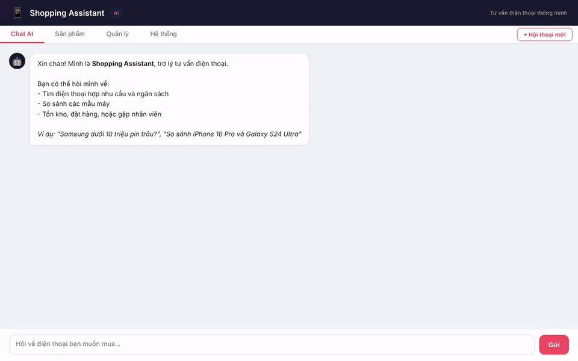

*Demo recorded with Playwright ([MP4](docs/demo.mp4)): the chat window on the Odoo shop, a filtered search, a comparison table built in code, the order confirmation card, and the confirmed sales order in the Odoo backend. The same flow in Vietnamese: [GIF](docs/demo-vi.gif) · [MP4](docs/demo-vi.mp4).*

## Results

| What | Result | Details |
| --- | --- | --- |
| Conversation task success, against Odoo | **100%** (46/46) in one clean run, all scenarios on one commit; two earlier runs scored 45/46, each finding a bug that was then fixed | [report](docs/agent_eval.md), earlier runs: [1](https://github.com/duyle215/shopping-assistant-agent/blob/b8d3bab/docs/agent_eval.md) |
| Answers grounded in tool data (LLM judge) | 95% (41/43); both flagged answers reuse data from an earlier turn, which the judge does not see | same report |
| Spec extraction, field accuracy | **99.5%** (418/420) | [docs/extraction_eval.md](docs/extraction_eval.md) |
| Search Hit@1, name / feature queries | 100% / 90% | [docs/search_eval.md](docs/search_eval.md) |
| Prompt-injection attacks blocked | regex 17/20, LLM 19/20, both **20/20**; 0/15 benign messages blocked | [docs/guardrail_eval.md](docs/guardrail_eval.md) |
| Overselling under concurrent orders, in Odoo | 8 buyers, 1 unit: 1 order confirmed in 5 of 5 rounds; **8 of 8** confirmed in every round with the product-row write removed | `tests/test_place_order.py` (3 rounds); 5-round measurement with and without the write |

Measured with `gemini-3.5-flash-lite` on a 30-phone catalog; the conversation scenarios ran against Odoo 19 (`odoo_eval` database). The standalone version scored 37/40 in its clean run ([report](https://github.com/duyle215/shopping-assistant-agent/blob/ca3716b6d8d6b371719a4cc3c41ad87163d07808/docs/agent_eval.md)). The scenarios are written for this catalog and the judge is the same model, so treat the numbers as a regression baseline, not a benchmark. The Vietnamese regex patterns were added after a first run on the injection set (8/20 before), so the regex row is optimistic; the LLM row was not tuned on it.

## Highlights

- **Odoo is the backend.** Phones are `product.template` records with typed spec fields from a small addon; stock is Odoo Inventory (`free_qty`: on hand minus what confirmed orders reserved); an order is a `res.partner` plus a `sale.order`, confirmed when stock is free and left as a quotation for staff when it is not; a request for staff is a `crm.lead` (Helpdesk is Enterprise-only). Staff work in Odoo as usual.
- **Least-privilege API user.** The chatbot calls Odoo's JSON-2 API with an API key of a user that can sell, reserve stock and create leads, but cannot edit products or stock levels. A second user, used only by the catalog sync and the evaluation reset, manages products and stock.
- **No overselling, enforced inside Odoo.** `chat_place_order` (in the addon) checks stock, creates and confirms the order in one database transaction, and writes the product row first. Odoo runs transactions in `REPEATABLE READ`, so a concurrent order for the same phone fails with a serialisation error and is retried on fresh data. 8 buyers racing for the last unit: exactly 1 confirmed order in every round; with the row write removed, all 8 orders were confirmed for 1 unit.
- **Chat on the Odoo website.** The addon adds a floating chat button to every website page; it opens the app's `/embed` page in an iframe, in the visitor's website language. The app URL is a system parameter.
- **LangGraph agent graph.** Handoffs, tool calls, answer checks and order confirmation are nodes and edges of a `StateGraph`. State is checkpointed in PostgreSQL, so a restart does not lose conversations.
- **Human approval before orders.** `place_order` pauses the graph with `interrupt()`. The customer sees product, quantity, total and recipient, then clicks Confirm or Cancel. An abandoned confirmation never becomes an order. Name and phone are required before the card is shown.
- **Streaming.** Answers stream over Server-Sent Events, with the tool currently running ("Đang tìm sản phẩm…").
- **Comparisons without invented numbers.** `compare_products` builds the table and per-aspect winners from the database. Any number in the answer that is not in the tool output sends the agent back for a rewrite.
- **Claimed actions are verified.** "Your order is placed" or "staff will call you" without the matching tool call sends the agent back to do it.
- **Typed catalog from LLM extraction.** Raw product pages → Structured Outputs → normalisation and validation → `catalog.jsonl` → Odoo products (spec fields, price, stock) and Qdrant payloads.
- **Hybrid search.** Structured filters (price, brand, RAM, battery, storage, refresh rate) become Odoo domains, "the cheapest / the biggest battery" becomes an Odoo sort; name matching uses word trigrams and needs ("good for gaming") use vectors in Qdrant, merged with Reciprocal Rank Fusion. Every result is re-checked against Odoo, so a phone archived or repriced in Odoo drops out even if Qdrant is stale. When the embedding API fails, search falls back to names.
- **Keeps answering when a quota runs out.** Rate limits are retried with the provider's suggested wait. When a model's daily quota is used up, calls switch to `LLM_FALLBACK_MODEL` until it resets; if nothing is left, the customer gets a polite "busy" message instead of an error.
- **Tracing.** Every LLM call (latency, tokens), tool call and turn is stored and summarised in the System tab.
- **Vietnamese and English.** A VI | EN switch in the UI; the language is sent with each request, so answers, comparison tables, fixed messages and number formats follow it. Claimed-action checks and evaluation scenarios cover both languages.
- **MCP server.** The shop tools (search, specs, stock, comparison, ordering into Odoo) are also exposed over the Model Context Protocol for other agents.

## Screenshots

| Chat window on the Odoo website | The chatbot's order in Odoo Sales |
| --- | --- |
| 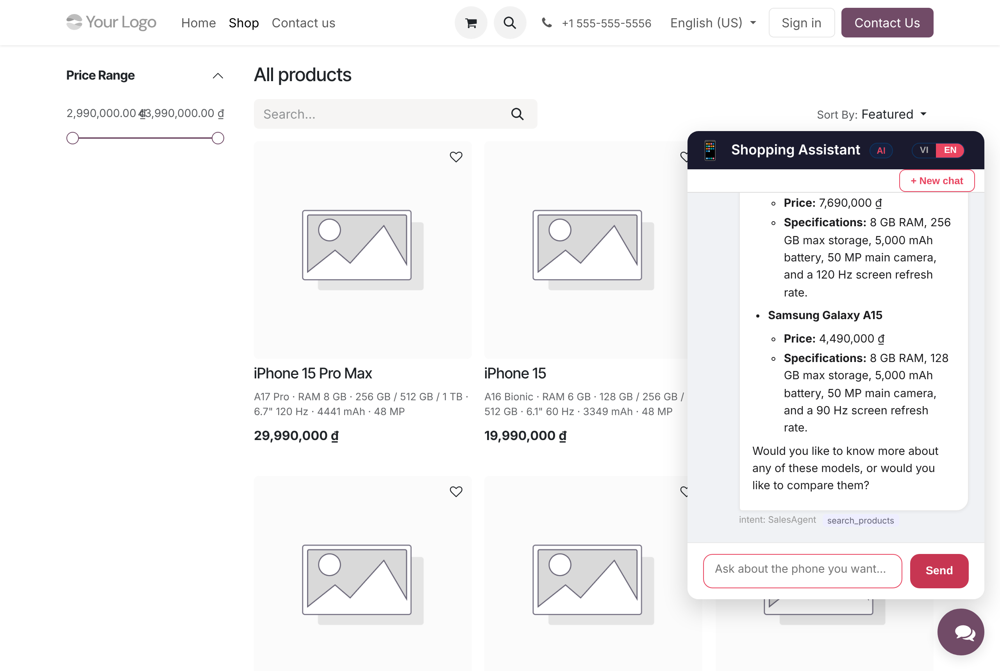 | 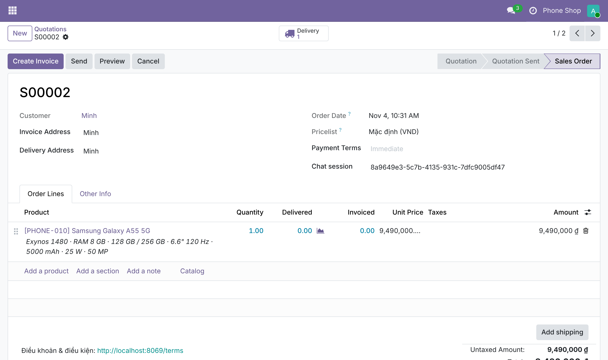 |

| Support requests in the Odoo CRM pipeline | Phone specs on the Odoo product form (addon) |
| --- | --- |
| 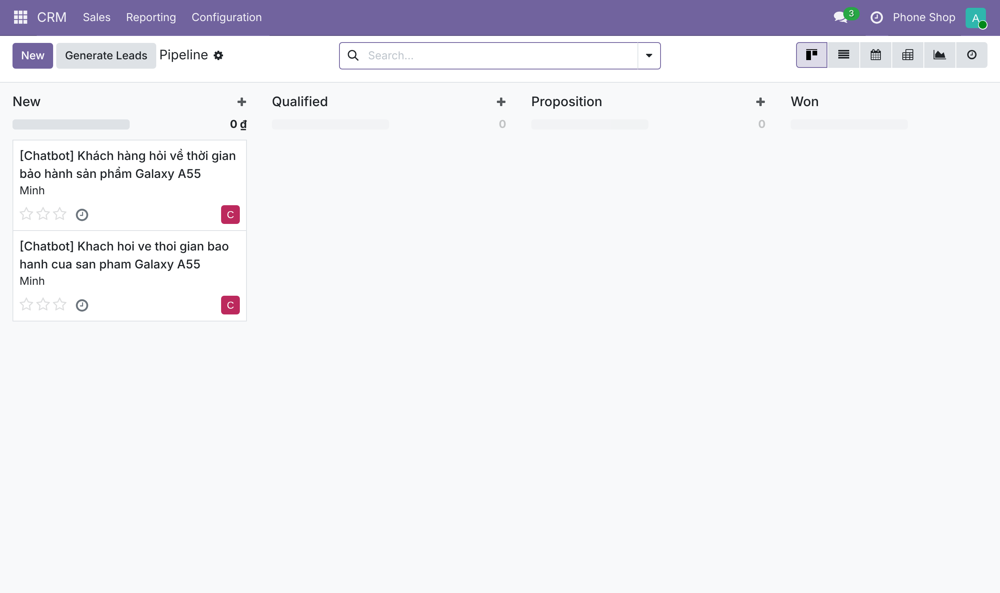 | 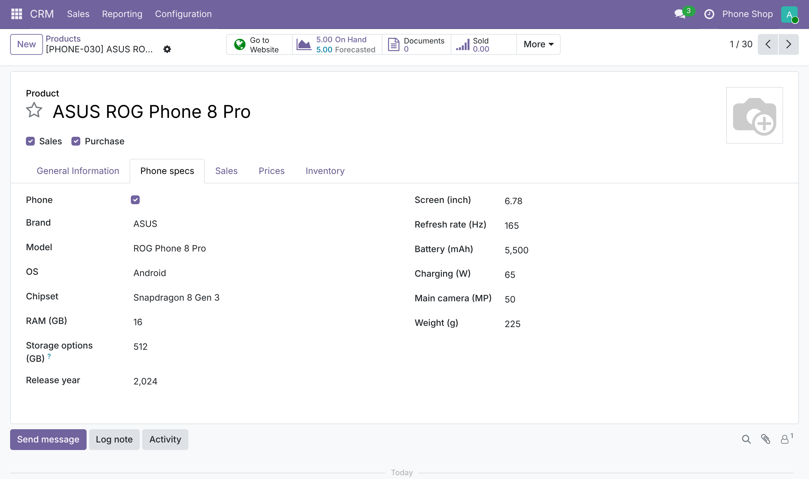 |

| Order confirmation (graph interrupt) | Filtered search |
| --- | --- |
| 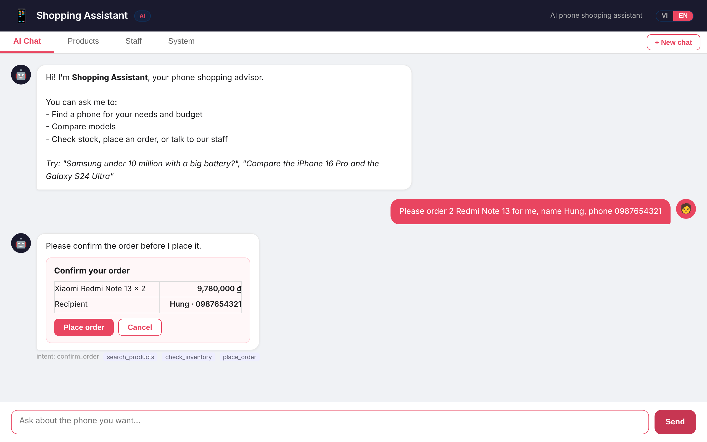 | 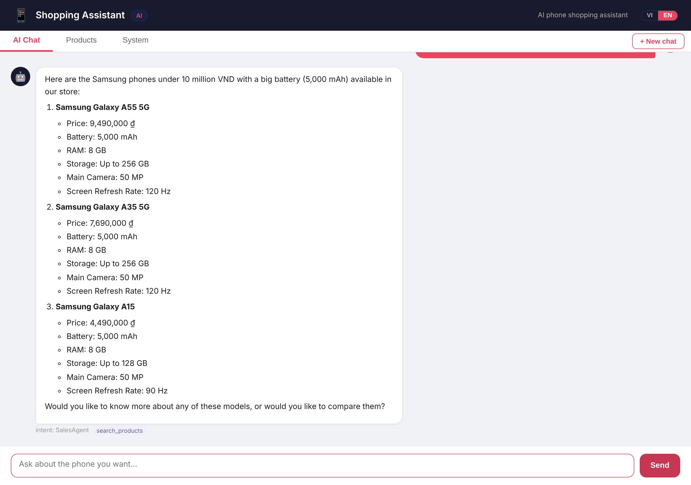 |

| Order, then an out-of-scope question goes to staff | System tab: Odoo status and traces from the last 24 hours |
| --- | --- |
| 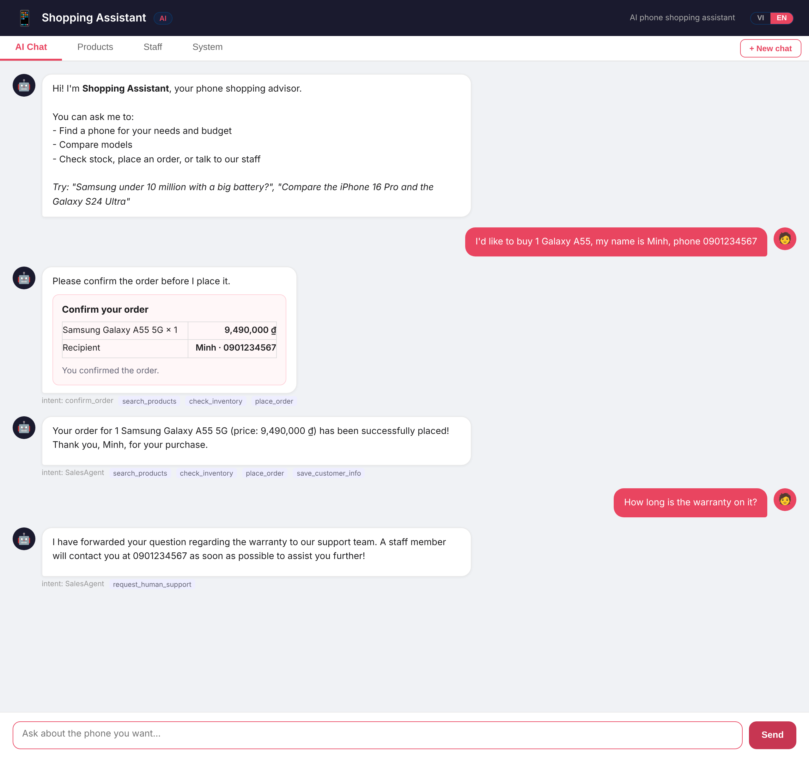 | 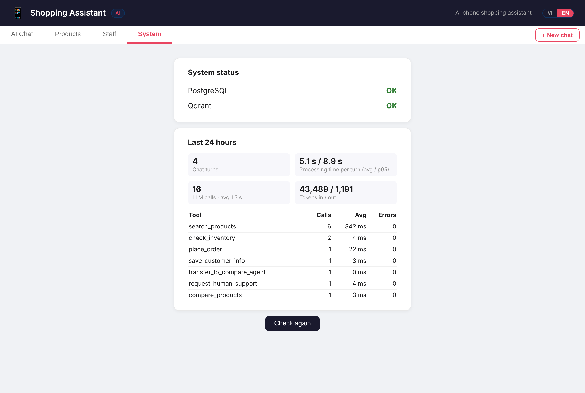 |

Three-way comparison: the table and the ✓ marks are computed in code, the model only writes the commentary.
Vietnamese versions of the chat screenshots are in [`docs/screenshots/`](docs/screenshots/).

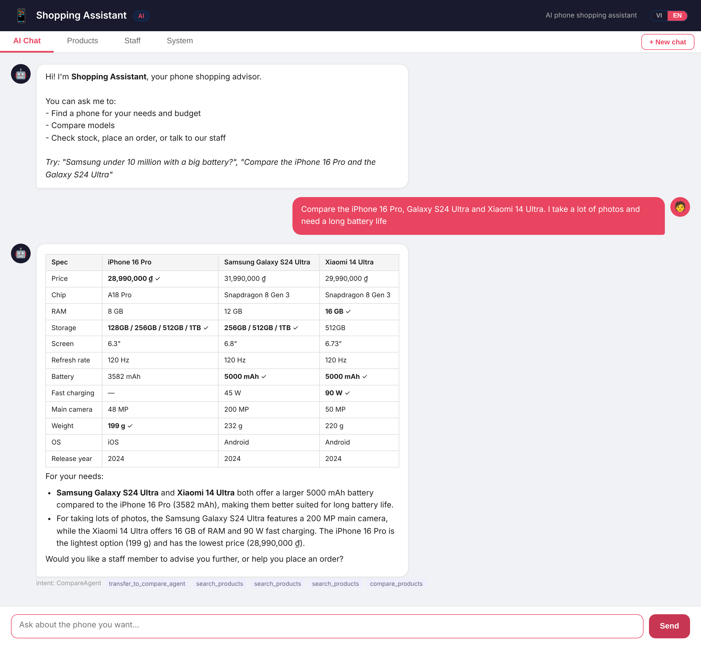

## Architecture

### Agent graph


State (conversation history, current agent, pending confirmation) is checkpointed in PostgreSQL with `PostgresSaver`, keyed by session id.

LLM calls use the OpenAI client directly instead of a framework wrapper. Gemini 3 returns a `thought_signature` with each tool call, and it must be sent back on the next request (dropping it returns HTTP 400). Keeping the raw message dicts in the graph state preserves it.

### Data flow

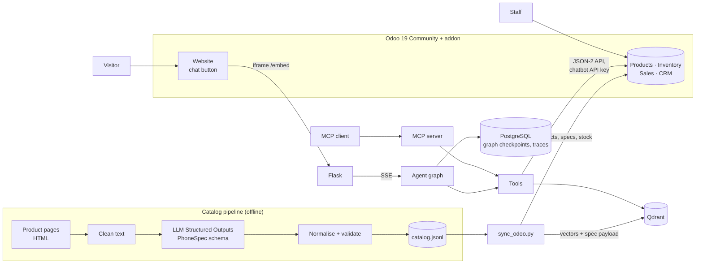

Odoo and the agent share one PostgreSQL container with separate databases and roles.

### Agents and tools

| Tool | Sales | Compare | What it does |
| --- | :---: | :---: | --- |
| `search_products` | ✓ | ✓ | Hybrid search with filters (brand, OS, price, RAM, battery, storage, refresh rate) or `sort_by` a spec, checked against Odoo |
| `get_product_details` | ✓ | ✓ | Full typed spec sheet from the Odoo product |
| `compare_products` | | ✓ | 2–4 products: Markdown table and per-aspect winners, computed in code from Odoo data |
| `check_inventory` | ✓ | | Units free to sell in Odoo Inventory, and a status |
| `place_order` | ✓ | | Pauses for confirmation, then creates the Odoo sales order: confirmed with stock reserved, or a quotation waiting for restock |
| `save_customer_info` | ✓ | ✓ | Attaches name and phone to a waiting quotation or a support request of this chat |
| `request_human_support` | ✓ | ✓ | Opens a CRM lead for staff (warranty, returns, payment…) linked to the chat session |
| `transfer_to_compare_agent` / `transfer_to_sales_agent` | ✓ / | / ✓ | Handoffs |

## How it works

### 1. Catalog from structured extraction

[`app/catalog.py`](app/catalog.py) defines `PhoneSpec`, a Pydantic model with 14 typed fields. [`scripts/extract_catalog.py`](scripts/extract_catalog.py) strips each page to text, asks the LLM for a `PhoneSpec` with a strict JSON schema, normalises it (brand names, `Qualcomm Snapdragon … for Galaxy` → `Snapdragon …`, `1TB` → `1024`), rejects values out of range, and writes `data/catalog.jsonl`. The catalog is committed, so the app runs without calling the LLM again. [`scripts/sync_odoo.py`](scripts/sync_odoo.py) loads it into Odoo (products keyed by internal reference `PHONE-001`…, spec fields, sale price, stock from `data/stock.json` applied as an inventory count) and then into Qdrant.

The 30 pages in [`data/raw_pages/`](data/raw_pages/) are written to be tricky: list price next to the sale price, instalments, gifts, `6,7 inch`, `5.000 mAh`, `28,99 triệu`, and missing fields that must come back as `null`. [`scripts/eval_extraction.py`](scripts/eval_extraction.py) compares the result with hand-labelled answers: **418/420 fields (99.5%)**. Both errors kept a "5G" suffix in the model name. Real retail pages are noisier, so expect lower accuracy on crawled data.

### 2. Hybrid search

Specs are typed fields on the Odoo product and payload in Qdrant. The tool schema tells the model how to turn needs into filters ("under 10 million" → `price_max`, "smooth screen" → `refresh_rate_min`); the filters become an Odoo domain (`list_price <= 10000000`, `phone_refresh_rate_hz >= 120`). Superlatives ("cheapest", "biggest battery", "highest refresh rate") use `sort_by`, which asks Odoo for the filtered products ordered by the real spec instead of by relevance. Vector search handles needs ("good for gaming"); name matching with word trigrams (the `pg_trgm` method, in Python over the Odoo product names) handles exact models ("Redmi 13C" vs "Redmi Note 13"). Both use the same filters and are merged with Reciprocal Rank Fusion, then loaded from Odoo with the filters applied again.

[`scripts/eval_search.py`](scripts/eval_search.py) runs 30 name queries (often shortened: `ip 16`, `A55`) and 10 feature queries. On this small catalog, vector search alone already gets 100% Hit@1 on names, and hybrid matches it. The first hybrid version dropped to 83% because `"iphone 15"` matched `"iPhone 15 Pro Max"` as fully as `"iPhone 15"`; ties are now broken by whole-name similarity. Hybrid search keeps exact-name lookups working as the catalog grows, and keeps search working when the embedding quota runs out.

### 3. Comparisons computed in code

[`app/services/compare.py`](app/services/compare.py) builds the table from the Odoo products. Each aspect knows whether higher or lower is better (price and weight: lower; battery, RAM, charging: higher). Camera megapixels, chip and screen size are shown but not scored. After the answer, every number must appear in the tool output (`22,99 triệu` and `22.990.000 ₫` count as the same number); otherwise the agent rewrites once.

### 4. Orders: confirmation, then one transaction in Odoo

The `confirm_order` node calls `interrupt()` with the order details. The UI shows a card with Confirm / Cancel. The API returns `pending_confirmation` and takes the answer at `/api/chat/confirm`. Sending a new message instead cancels the pending order.

After approval, `place_order` calls `sale.order.chat_place_order` in the addon. In one Odoo transaction it writes the product row (a lock), reads the free quantity, finds the customer by phone or creates a contact, creates the sales order with the chat session id, and either confirms it (Odoo reserves the units on the delivery order) or leaves it as a quotation with the missing quantity for staff. Splitting this into separate API calls (check stock, create, confirm) would let two customers both see the last unit. The test starts 8 threads on a phone with 1 unit, three times: each time exactly one order is confirmed and 7 wait for restock.

### 5. Odoo integration

| Shop concept | Odoo |
| --- | --- |
| Phone and its specs | `product.template` (storable) with `phone_*` fields from the addon, published on the website |
| Stock | Odoo Inventory; the bot uses `free_qty` (on hand minus reserved) |
| Order | `res.partner` (matched by phone) + `sale.order`, confirmed by `action_confirm`, or a quotation with `chat_shortage` |
| Request for staff | `crm.lead` with `chat_session_id`; name and phone can be added later in the chat |
| Chat on the website | QWeb template on `website.layout`: button + iframe to `<app>/embed?lang=…`; URL in the system parameter `shopping_assistant_chat.app_url` |

`docker compose run --rm odoo-setup [db]` creates or updates a database: installs `sale_stock`, `crm`, `website_sale` and the addon, sets the company currency to VND, adds Vietnamese to the website, sets the chat URL, and creates the two API users with keys in `odoo/secrets/<db>.json` (git-ignored, read by the app). Odoo talks JSON-2 (`POST /json/2/<model>/<method>`, `Authorization: bearer <key>`, `X-Odoo-Database`), the API Odoo 19 introduced to replace XML-RPC / JSON-RPC. The agent's own database keeps only LangGraph checkpoints and traces.

### 6. Guardrails

- **Input, layer 1 (regex):** English and Vietnamese patterns for rule overrides, role play, prompt and key requests, chat-template tokens.
- **Input, layer 2 (optional LLM classifier):** set `GUARD_MODEL` to classify each message as injection or not. It costs one extra call per message and fails open when the API errors.
- **Output:** blocks leaked internals (system prompt, vector-store details, API keys).
- **Claimed actions** and **comparison numbers**: checked in the graph's `check` node.
- The server injects the real `session_id` into support tools, so the model never has to guess it.

### 7. Evaluation

[`evals/scenarios.yaml`](evals/scenarios.yaml) holds 46 conversations in seven groups: search, compare, order, support, multi-turn context, safety, and English (the same flows with the UI set to English, plus a check that the answer really is in English). Each turn can require or forbid tools, check tool arguments (`price_max <= 10000000`, `product_ids contains [3, 6]`), the answering agent, answer content, the confirmation card, and Odoo changes after the scenario (the session's sales orders and their state, free stock, CRM leads). Every answer is also checked for prices that are not in the catalog.

[`scripts/eval_agent.py`](scripts/eval_agent.py) runs them on a separate Odoo database (`odoo_eval`): before each scenario it cancels the chatbot's orders and resets stock through the API. Scenario product ids are catalog ids, mapped to Odoo ids by internal reference. It retries after rate limits and can add an LLM judge that compares the last answer with the data the tools returned (`--judge`). The judge uses the same model as the agent, so it can share its blind spots. Each report records the commit every scenario ran on.

What the evaluation caught and what changed:

| Found | Fix |
| --- | --- |
| After a comparison, "get me one" opened a support ticket instead of an order | CompareAgent hands buying requests to SalesAgent |
| "I want to buy a vivo Y36" created an order with no recipient | `place_order` without name and phone skips the confirmation and asks for them (graph routing) |
| Answers added features from the model's own knowledge ("transparent back") | Prompt limits descriptions to tool data; judge checks it |
| "Highest refresh rate for gaming" missed the 165 Hz phone | Search returns refresh rate and supports `sort_by` |
| "I'll forward this to our staff" without opening a ticket | Claimed-action check covers forwarding phrases |
| A poem request opened a support ticket | Off-topic requests are declined without a ticket |
| "Samsung foldable" was searched as `gap` without diacritics and missed the Fold6 / Flip6 (first run on Odoo) | The search tool asks for the customer's words with Vietnamese diacritics |
| "Compare the iPhone 15 with the Nokia 3310": the correct "we don't sell it" answer was sent back for a rewrite because 3310 is not in the table | Numbers the customer typed count as known in the number check |

### 8. Tracing

Each LLM call stores agent, model, latency and tokens; each tool call stores latency, arguments and errors; each turn stores its processing time (LLM + tools, without the time a customer takes to confirm an order), tools, retries and warnings. `/api/traces` lists them and `/api/traces/summary` powers the System tab (turns, average and p95 latency, tokens, per-tool calls and errors).

## Tech stack

| Area | Technology |
| --- | --- |
| Business backend | Odoo 19 Community (Sales, Inventory, CRM, Website), JSON-2 API, custom addon |
| Orchestration | LangGraph (`StateGraph`, `interrupt`, `PostgresSaver`) |
| LLM | Any OpenAI-compatible API (OpenAI `gpt-4.1-mini`, Gemini `gemini-3.5-flash-lite`) |
| Structured extraction | Structured Outputs with a Pydantic schema |
| Embeddings | `text-embedding-3-small` or `gemini-embedding-001` |
| Search | Qdrant (vectors + payload filters), Odoo domains and ordering, word trigrams, Reciprocal Rank Fusion |
| Database | PostgreSQL 16 (Odoo; agent checkpoints and traces), SQLAlchemy 2, psycopg 3 |
| Backend | Flask, Server-Sent Events, gunicorn |
| Frontend | HTML, CSS, JavaScript, marked.js |
| Interop | MCP server (`mcp` SDK) |
| Quality | pytest (against a real Odoo test database), scripted conversation evals, LLM judge, GitHub Actions |
| Deployment | Docker Compose |

## Getting started

### Option A: Docker (recommended)

```bash
git clone https://github.com/duyle215/shopping-assistant-agent.git
cd shopping-assistant-agent
cp .env.example .env    # LLM key, POSTGRES_PASSWORD, ODOO_DB_PASSWORD, ODOO_ADMIN_PASSWORD
docker compose up -d --build
docker compose run --rm odoo-setup                        # once, about 2 minutes: database, addon, API users
docker compose run --rm app python scripts/sync_odoo.py   # catalog -> Odoo -> Qdrant
```

Open http://localhost:8069 for the Odoo shop (chat button at the bottom right; staff log in as `admin` with `ODOO_ADMIN_PASSWORD`) and http://localhost:5000 for the full chat page. Running `odoo-setup` again updates the addon and rotates the API keys; restart the app afterwards (`docker compose restart app`).

### Option B: Run the app locally

Odoo, PostgreSQL and Qdrant still run in Docker; `docker-compose.dev.yml` publishes their ports. Requirements: Python 3.10+ and an OpenAI or Gemini API key.

```bash
python -m venv .venv
.venv\Scripts\activate            # Windows
# source .venv/bin/activate       # Linux / macOS
pip install -r requirements.txt
cp .env.example .env              # then edit it; set QDRANT_URL=http://localhost:6333
docker compose -f docker-compose.yml -f docker-compose.dev.yml up -d postgres qdrant odoo
docker compose run --rm odoo-setup
python scripts/check_health.py    # expects: Postgres OK, Qdrant OK, Odoo OK
python scripts/sync_odoo.py       # catalog -> Odoo -> Qdrant
python run.py                     # http://localhost:5000
```

### Choosing a provider

`.env.example` has both options. For Gemini:

```ini
OPENAI_BASE_URL=https://generativelanguage.googleapis.com/v1beta/openai/
OPENAI_API_KEY=your_gemini_api_key
LLM_MODEL=gemini-3.5-flash-lite
EMBED_MODEL=gemini-embedding-001
EMBED_DIM=3072
```

After changing `EMBED_MODEL` or `EMBED_DIM`, run `scripts/sync_odoo.py` again.

Free-tier limits are per model, per minute and per day, and they differ a lot between models (when tested: 500 requests/day for `gemini-3.5-flash-lite`, 20/day for `gemini-3.5-flash`). One chat turn takes about 2–3 requests. Useful settings:

- `LLM_FALLBACK_MODEL`: model to use when `LLM_MODEL` runs out of quota.
- `EXTRACT_MODEL` and `--judge-model`: run extraction and evaluation judging on other models to spare the chatbot's quota.

### MCP server

```bash
python -m app.mcp_server            # stdio
python -m app.mcp_server --http     # streamable HTTP on http://localhost:8000/mcp
```

Tools: `search_products`, `get_product`, `check_inventory`, `compare_products` (read-only) and `place_order` (creates the Odoo sales order; name and phone required). Example client config: `{"command": "python", "args": ["-m", "app.mcp_server"], "cwd": "<project folder>"}`.

## Scripts

| Script | Purpose |
| --- | --- |
| `scripts/check_health.py` | Check PostgreSQL, Qdrant and Odoo |
| `scripts/extract_catalog.py` | Product pages → `PhoneSpec` → `data/catalog.jsonl` (`--only`, `--max-pages`) |
| `scripts/eval_extraction.py` | Per-field extraction accuracy → `docs/extraction_eval.md` |
| `scripts/sync_odoo.py` | Load one or more catalog files into Odoo (products, specs, stock) and Qdrant (`--db`, `--skip-qdrant`) |
| `scripts/eval_search.py` | Dense vs keyword vs hybrid search → `docs/search_eval.md` |
| `scripts/eval_agent.py` | Scripted conversations on the `odoo_eval` database (+ `--judge`) → `docs/agent_eval.md` |
| `scripts/eval_guardrails.py` | Regex (+ `--llm`) guardrail on attacks and benign messages → `docs/guardrail_eval.md` |
| `scripts/crawl_pages.py` | Slow, polite crawler for real product pages |
| `scripts/demo/*.js` | Playwright: chat and Odoo screenshots, the demo video (`ffmpeg` turns it into `docs/demo.gif`) |

### Crawling real pages

`crawl_pages.py` reads each site's `robots.txt` and skips disallowed URLs, waits at least 5 seconds (or the site's `Crawl-delay`) between requests, stops after `--max-pages`, and resumes where it left off. Pages go to `data/crawled/`, which is git-ignored. Do not commit other sites' content, and read each site's terms before crawling.

```bash
cp data/crawl_urls.example.txt data/crawl_urls.txt    # add product page URLs
python scripts/crawl_pages.py --urls data/crawl_urls.txt --max-pages 50
python scripts/extract_catalog.py --pages data/crawled --out data/catalog_crawled.jsonl --max-pages 50
python scripts/sync_odoo.py --catalog data/catalog.jsonl data/catalog_crawled.jsonl
```

## API

| Method | Endpoint | Description |
| --- | --- | --- |
| GET | `/` | Chat UI (chat, products, system) |
| GET | `/embed` | Chat only, for the iframe on the Odoo website (`?lang=vi\|en`) |
| POST | `/api/chat` | `{"message", "session_id", "lang"}` (`lang`: `vi` default or `en`) → answer, agent, tools, warning, `pending_confirmation` |
| POST | `/api/chat/stream` | Same, as Server-Sent Events: `tool`, `token`, `reset`, `final` |
| POST | `/api/chat/confirm` (`/stream`) | `{"session_id", "approved", "lang"}`: answer a pending order confirmation |
| GET | `/api/products` | Phones from Odoo with typed specs and free stock |
| GET | `/api/traces`, `/api/traces/summary` | Recent steps; 24-hour summary |
| POST | `/api/session/clear` | Delete a conversation's saved state |
| GET | `/api/health` | PostgreSQL, Qdrant and Odoo status |

Staff tools (stock, orders, support requests) are Odoo's own apps; the earlier staff tab and its endpoints were removed.

## Tests

```bash
pip install -r requirements-dev.txt
docker compose run --rm odoo-setup odoo_test
ODOO_DB_FILTER=^odoo docker compose -f docker-compose.yml -f docker-compose.dev.yml up -d odoo
pytest
```

Odoo serves one database to the website by default (`ODOO_DB_FILTER=^odoo$`); the test and evaluation databases (`odoo_test`, `odoo_eval`) need the wider filter. Tests use their own agent database (`shopping_assistant_test`, created automatically) and skip what needs PostgreSQL or Odoo when they are not running. They cover the agent graph with a scripted LLM (confirmation, cancellation, handoff, rewrites, `thought_signature` round-trip, history), and against the Odoo test database: orders, stock reservation, quotations waiting for restock, customer matching by phone, the concurrency race, the chatbot user's missing product rights, CRM leads, hybrid search and filters, and the MCP server; plus extraction helpers, comparison and the number check, and guardrails. The GitHub Actions workflow starts Odoo with Docker Compose and runs them; the conversation evaluation runs on manual dispatch with an `LLM_API_KEY` secret.

## Project structure

```
.
├── run.py                      # Entry point
├── app/
│   ├── config.py               # Settings from .env
│   ├── odoo.py                 # Odoo JSON-2 client (API key, retries on serialisation conflicts)
│   ├── db.py                   # Shared PostgreSQL engine (agent database) and Qdrant client
│   ├── models.py               # Agent table: traces
│   ├── catalog.py              # PhoneSpec schema, HTML cleaning, normalisation, validation
│   ├── guardrails.py           # Input (regex + optional LLM), output and claimed-action checks
│   ├── tracing.py              # Trace records and summaries
│   ├── mcp_server.py           # MCP server for the shop tools
│   ├── routes.py               # REST + SSE API and UI
│   ├── agent/
│   │   ├── graph.py            # LangGraph StateGraph: nodes, edges, interrupt
│   │   ├── core.py             # ShoppingAgent: checkpointer, run / stream / confirm
│   │   ├── llm.py              # Streaming LLM client: keeps provider fields, retries, model fallback
│   │   ├── tools.py            # Tool schemas and dispatch
│   │   ├── prompts.py          # System prompts and per-agent tool sets
│   │   └── schemas.py          # Pydantic models
│   └── services/               # search (hybrid), compare, product, inventory, support (all on Odoo)
├── odoo/
│   ├── addons/shopping_assistant_chat/   # Spec fields, chat_place_order, chat session on orders/leads, website chat button
│   ├── setup_db.sh, setup_odoo.py        # odoo-setup: install, VND, website languages, API users and keys
│   ├── odoo.conf, postgres-init.sh
│   └── secrets/                          # <db>.json with API keys (git-ignored)
├── scripts/                    # Extraction, Odoo sync, crawling, evaluations, health check
├── evals/                      # Conversation scenarios, search queries, injection set
├── data/                       # Sample pages, gold labels, extracted catalog, stock
├── docs/                       # Evaluation reports and screenshots
├── tests/
├── templates/index.html        # Single-page UI (VI/EN, streaming, confirmation card, stats)
├── .github/workflows/ci.yml
├── Dockerfile
├── docker-compose.yml          # PostgreSQL, Odoo, odoo-setup, Qdrant, app
└── docker-compose.dev.yml      # Publishes PostgreSQL and Qdrant for local runs
```

## Roadmap

**Done**
- [x] Row locks and a shared connection pool; concurrency test
- [x] `PhoneSpec`, typed product table, extraction pipeline, 30 hand-labelled pages
- [x] Hybrid search with structured filters, search evaluation
- [x] `compare_products` computed in code, number check on answers
- [x] LangGraph graph, PostgreSQL checkpoints, confirmation before orders, streaming
- [x] Scripted conversation evaluation with an LLM judge, injection set, CI
- [x] Tracing, optional LLM guardrail, MCP server, Docker Compose
- [x] Odoo 19 as the backend: products, stock, sales orders, CRM leads; chat on the Odoo website

**Next**
- [ ] Re-index a product in Qdrant when staff change it in Odoo (automated action or webhook), instead of re-running the sync
- [ ] Hand the conversation to a staff member live (Odoo Live Chat) instead of a CRM lead
- [ ] Product images and Odoo pricelists / promotions in answers
- [ ] Grow the catalog to 200–500 phones from crawled pages and measure extraction on real pages
- [ ] More product types (laptops, accessories) with their own spec schemas
- [ ] Photo input: read a listing or price tag with a vision model and check it against the catalog
- [ ] Export traces to an observability tool (OpenTelemetry / Langfuse)
- [ ] Cost per turn from provider pricing

## Known limitations

- The catalog and prices are written for this demo. Check real prices and specs before relying on them.
- Vectors in Qdrant are built by `sync_odoo.py`. Prices, specs used as filters, stock and archiving are read live from Odoo, but a changed product description only reaches vector search after the next sync.
- The order flow stops at the sales order: no payment, delivery fee or shipping address. Odoo reserves stock; staff handle the rest.
- The overselling guarantee covers orders placed through `chat_place_order`. Orders entered by other means use Odoo's normal rules, which allow confirming an order without stock.
- The evaluation scenarios were written alongside the system and the judge is the same model as the agent, so the scores are a regression check, not an independent benchmark.
- The model can still add details from its own knowledge in free-text answers. Comparisons are protected by the number check; other answers are covered only by the judge.
- On a free API tier, a full evaluation run (about 150 requests with the judge) uses a large share of the daily quota of one model.

## License

GPL-3.0. See [LICENSE](LICENSE).
