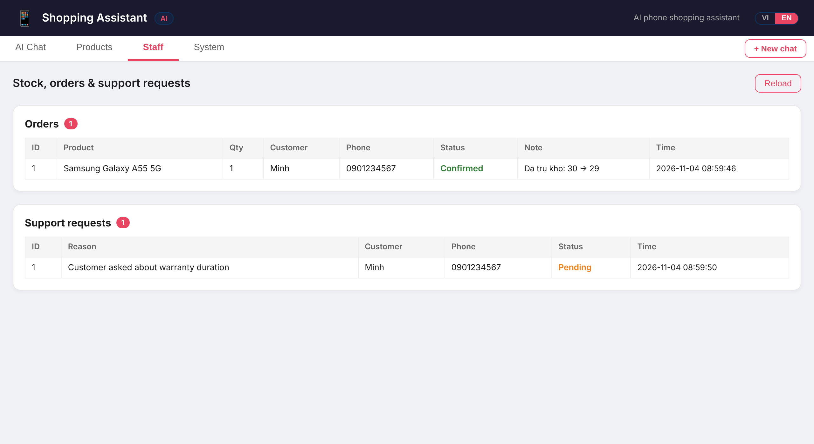
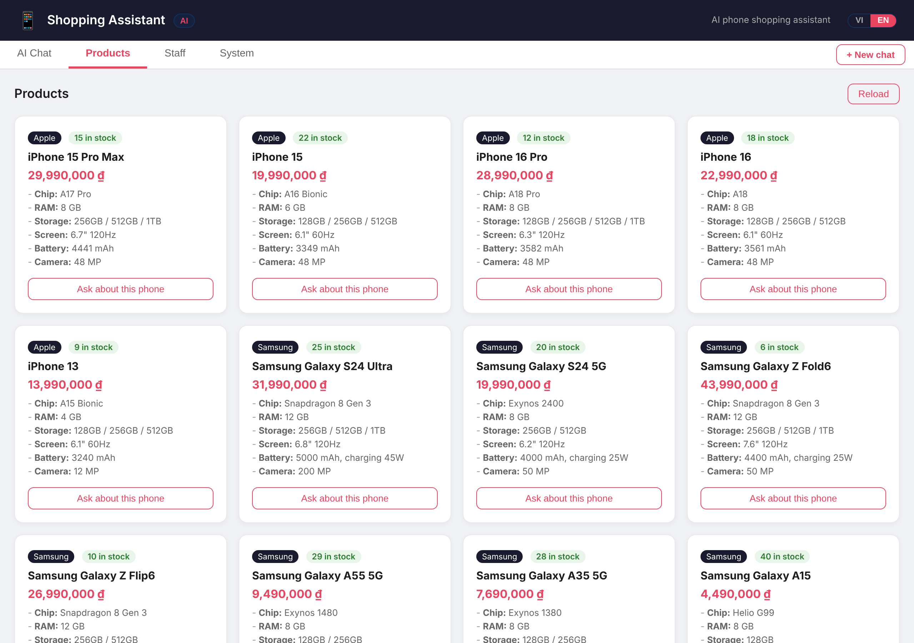
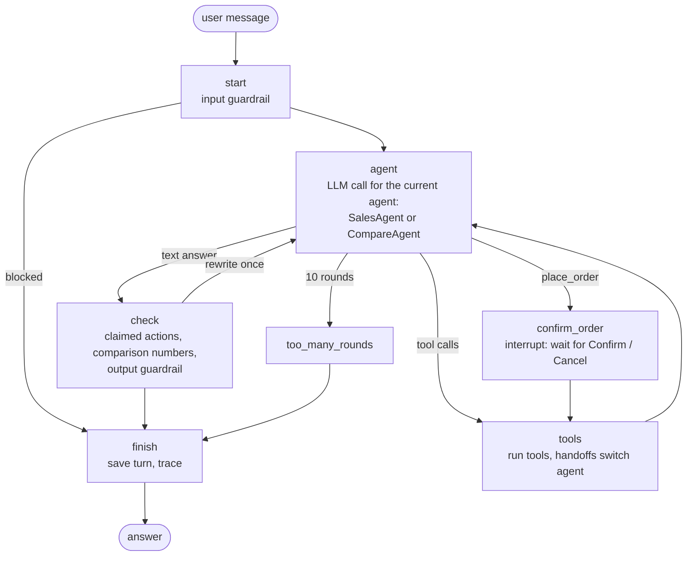
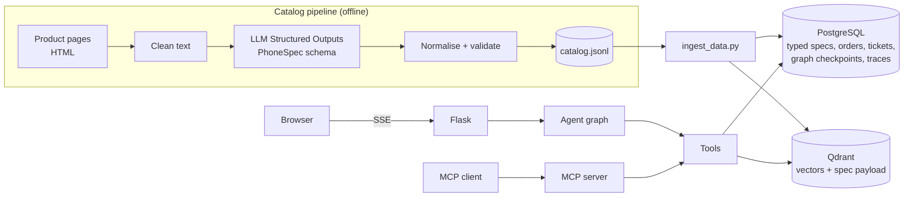

# Shopping Assistant Agent

A bilingual (Vietnamese / English) phone-shopping assistant built on **LangGraph**. Two agents hand off to each other to search, compare, check stock, take orders and escalate to staff. Orders wait for the customer's confirmation, and conversations are saved in PostgreSQL. The catalog comes from an **LLM structured-extraction pipeline**, and comparisons are computed in code, so the bot cannot misread or invent specs. Every claim is measured: extraction accuracy, search quality, guardrails, and 46 scripted conversations.

Works with any OpenAI-compatible provider. Tested with OpenAI and with Google Gemini's free tier.


*Demo recorded with Playwright against the Docker build ([MP4](docs/demo.mp4)): filtered search, a comparison table built in code, the order confirmation card, and the new order in the staff view. The same flow in Vietnamese: [GIF](docs/demo-vi.gif) · [MP4](docs/demo-vi.mp4).*

## Results

| What | Result | Details |
| --- | --- | --- |
| Conversation task success | **92%** (37/40) in one clean run; **100%** (46/46, incl. 6 English scenarios) after fixing the failures it found | [clean run](https://github.com/duyle215/shopping-assistant-agent/blob/ca3716b6d8d6b371719a4cc3c41ad87163d07808/docs/agent_eval.md), [after fixes](docs/agent_eval.md) |
| Answers grounded in tool data (LLM judge) | 97% (37/38) | same reports |
| Spec extraction, field accuracy | **99.5%** (418/420) | [docs/extraction_eval.md](docs/extraction_eval.md) |
| Search Hit@1, name / feature queries | 100% / 90% | [docs/search_eval.md](docs/search_eval.md) |
| Prompt-injection attacks blocked | regex 17/20, LLM 19/20, both **20/20**; 0/15 benign messages blocked | [docs/guardrail_eval.md](docs/guardrail_eval.md) |
| Overselling under concurrent orders | 1 of 8 buyers gets the last unit (5 of 8 without the row lock) | `tests/test_place_order.py` |

Measured with `gemini-3.5-flash-lite` on a 30-phone catalog. The scenarios are written for this catalog and the judge is the same model, so treat the numbers as a regression baseline, not a benchmark. The Vietnamese regex patterns were added after a first run on the injection set (8/20 before), so the regex row is optimistic; the LLM row was not tuned on it.

## Highlights

- **LangGraph agent graph.** Handoffs, tool calls, answer checks and order confirmation are nodes and edges of a `StateGraph`. State is checkpointed in PostgreSQL, so a restart does not lose conversations.
- **Human approval before orders.** `place_order` pauses the graph with `interrupt()`. The customer sees product, quantity, total and recipient, then clicks Confirm or Cancel. An abandoned confirmation never becomes an order.
- **Streaming.** Answers stream over Server-Sent Events, with the tool currently running ("Đang tìm sản phẩm…").
- **Comparisons without invented numbers.** `compare_products` builds the table and per-aspect winners from the database. Any number in the answer that is not in the tool output sends the agent back for a rewrite.
- **Claimed actions are verified.** "Your order is placed" or "staff will call you" without the matching tool call sends the agent back to do it.
- **Typed catalog from LLM extraction.** Raw product pages → Structured Outputs → normalisation and validation → typed PostgreSQL columns and Qdrant payloads.
- **Hybrid search.** Structured filters (price, brand, RAM, battery, storage, refresh rate) and spec sorting for "the cheapest / the biggest battery", keyword search with `pg_trgm` and vector search in Qdrant, merged with Reciprocal Rank Fusion. When the embedding API fails, search falls back to keywords.
- **Keeps answering when a quota runs out.** Rate limits are retried with the provider's suggested wait. When a model's daily quota is used up, calls switch to `LLM_FALLBACK_MODEL` until it resets; if nothing is left, the customer gets a polite "busy" message instead of an error.
- **Tracing.** Every LLM call (latency, tokens), tool call and turn is stored and summarised in the System tab.
- **Vietnamese and English.** A VI | EN switch in the UI; the language is sent with each request, so answers, comparison tables, fixed messages and number formats follow it. Claimed-action checks and evaluation scenarios cover both languages.
- **MCP server.** The inventory tools are also exposed over the Model Context Protocol for other agents.

## Screenshots

| Order confirmation (graph interrupt) | Filtered search |
| --- | --- |
|  |  |

| Out-of-scope question goes to staff | Staff view: orders and support requests |
| --- | --- |
|  |  |

| Catalog (typed specs) | System tab: traces from the last 24 hours |
| --- | --- |
|  |  |

Three-way comparison: the table and the ✓ marks are computed in code, the model only writes the commentary.
Vietnamese versions of all screenshots are in [`docs/screenshots/`](docs/screenshots/).


## Architecture

### Agent graph



State (conversation history, current agent, pending confirmation) is checkpointed in PostgreSQL with `PostgresSaver`, keyed by session id.

LLM calls use the OpenAI client directly instead of a framework wrapper. Gemini 3 returns a `thought_signature` with each tool call, and it must be sent back on the next request (dropping it returns HTTP 400). Keeping the raw message dicts in the graph state preserves it.

### Data flow



### Agents and tools

| Tool | Sales | Compare | What it does |
| --- | :---: | :---: | --- |
| `search_products` | ✓ | ✓ | Hybrid search with filters (brand, OS, price, RAM, battery, storage, refresh rate) or `sort_by` a spec |
| `get_product_details` | ✓ | ✓ | Full typed spec sheet |
| `compare_products` | | ✓ | 2–4 products: Markdown table and per-aspect winners, computed in code |
| `check_inventory` | ✓ | | Stock level and status |
| `place_order` | ✓ | | Pauses for confirmation, then locks the row and deducts stock (or records a pending-restock order) |
| `save_customer_info` | ✓ | ✓ | Attaches name and phone to a pending order or support request |
| `request_human_support` | ✓ | ✓ | Opens a ticket for staff (warranty, returns, payment…) |
| `transfer_to_compare_agent` / `transfer_to_sales_agent` | ✓ / | / ✓ | Handoffs |

## How it works

### 1. Catalog from structured extraction

[`app/catalog.py`](app/catalog.py) defines `PhoneSpec`, a Pydantic model with 14 typed fields. [`scripts/extract_catalog.py`](scripts/extract_catalog.py) strips each page to text, asks the LLM for a `PhoneSpec` with a strict JSON schema, normalises it (brand names, `Qualcomm Snapdragon … for Galaxy` → `Snapdragon …`, `1TB` → `1024`), rejects values out of range, and writes `data/catalog.jsonl`. The catalog is committed, so the app runs without calling the LLM again.

The 30 pages in [`data/raw_pages/`](data/raw_pages/) are written to be tricky: list price next to the sale price, instalments, gifts, `6,7 inch`, `5.000 mAh`, `28,99 triệu`, and missing fields that must come back as `null`. [`scripts/eval_extraction.py`](scripts/eval_extraction.py) compares the result with hand-labelled answers: **418/420 fields (99.5%)**. Both errors kept a "5G" suffix in the model name. Real retail pages are noisier, so expect lower accuracy on crawled data.

### 2. Hybrid search

Specs are typed columns in PostgreSQL and payload in Qdrant. The tool schema tells the model how to turn needs into filters ("under 10 million" → `price_max`, "smooth screen" → `refresh_rate_min`). Superlatives ("cheapest", "biggest battery", "highest refresh rate") use `sort_by`, which ranks the filtered products with SQL on the real specs instead of by relevance. Vector search handles needs ("good for gaming"); `pg_trgm` keyword search on names handles exact models ("Redmi 13C" vs "Redmi Note 13"). Both use the same filters and are merged with Reciprocal Rank Fusion.

[`scripts/eval_search.py`](scripts/eval_search.py) runs 30 name queries (often shortened: `ip 16`, `A55`) and 10 feature queries. On this small catalog, vector search alone already gets 100% Hit@1 on names, and hybrid matches it. The first hybrid version dropped to 83% because `"iphone 15"` matched `"iPhone 15 Pro Max"` as fully as `"iPhone 15"`; ties are now broken by whole-name similarity. Hybrid search keeps exact-name lookups working as the catalog grows, and keeps search working when the embedding quota runs out.

### 3. Comparisons computed in code

[`app/services/compare.py`](app/services/compare.py) builds the table from PostgreSQL. Each aspect knows whether higher or lower is better (price and weight: lower; battery, RAM, charging: higher). Camera megapixels, chip and screen size are shown but not scored. After the answer, every number must appear in the tool output (`22,99 triệu` and `22.990.000 ₫` count as the same number); otherwise the agent rewrites once.

### 4. Orders: confirmation and row locks

The `confirm_order` node calls `interrupt()` with the order details. The UI shows a card with Confirm / Cancel. The API returns `pending_confirmation` and takes the answer at `/api/chat/confirm`. Sending a new message instead cancels the pending order. After approval, `place_order` runs in one transaction with `SELECT … FOR UPDATE`.

### 5. Guardrails

- **Input, layer 1 (regex):** English and Vietnamese patterns for rule overrides, role play, prompt and key requests, chat-template tokens.
- **Input, layer 2 (optional LLM classifier):** set `GUARD_MODEL` to classify each message as injection or not. It costs one extra call per message and fails open when the API errors.
- **Output:** blocks leaked internals (system prompt, vector-store details, API keys).
- **Claimed actions** and **comparison numbers**: checked in the graph's `check` node.
- The server injects the real `session_id` into support tools, so the model never has to guess it.

### 6. Evaluation

[`evals/scenarios.yaml`](evals/scenarios.yaml) holds 46 conversations in seven groups: search, compare, order, support, multi-turn context, safety, and English (the same flows with the UI set to English, plus a check that the answer really is in English). Each turn can require or forbid tools, check tool arguments (`price_max <= 10000000`, `product_ids contains [3, 6]`), the answering agent, answer content, the confirmation card, and database changes after the scenario (orders, status, stock, support tickets). Every answer is also checked for prices that are not in the catalog.

[`scripts/eval_agent.py`](scripts/eval_agent.py) runs them on a separate database, retries after rate limits, and can add an LLM judge that compares the last answer with the data the tools returned (`--judge`). The judge uses the same model as the agent, so it can share its blind spots. Each report records the commit every scenario ran on.

What the evaluation caught and what changed:

| Found | Fix |
| --- | --- |
| After a comparison, "get me one" opened a support ticket instead of an order | CompareAgent hands buying requests to SalesAgent |
| "I want to buy a vivo Y36" created an order with no recipient | `place_order` without name and phone skips the confirmation and asks for them (graph routing) |
| Answers added features from the model's own knowledge ("transparent back") | Prompt limits descriptions to tool data; judge checks it |
| "Highest refresh rate for gaming" missed the 165 Hz phone | Search returns refresh rate and supports `sort_by` |
| "I'll forward this to our staff" without opening a ticket | Claimed-action check covers forwarding phrases |
| A poem request opened a support ticket | Off-topic requests are declined without a ticket |

### 7. Tracing

Each LLM call stores agent, model, latency and tokens; each tool call stores latency, arguments and errors; each turn stores its processing time (LLM + tools, without the time a customer takes to confirm an order), tools, retries and warnings. `/api/traces` lists them and `/api/traces/summary` powers the System tab (turns, average and p95 latency, tokens, per-tool calls and errors).

## Tech stack

| Area | Technology |
| --- | --- |
| Orchestration | LangGraph (`StateGraph`, `interrupt`, `PostgresSaver`) |
| LLM | Any OpenAI-compatible API (OpenAI `gpt-4.1-mini`, Gemini `gemini-3.5-flash-lite`) |
| Structured extraction | Structured Outputs with a Pydantic schema |
| Embeddings | `text-embedding-3-small` or `gemini-embedding-001` |
| Search | Qdrant (vectors + payload filters), PostgreSQL `pg_trgm`, Reciprocal Rank Fusion |
| Database | PostgreSQL 16, SQLAlchemy 2, psycopg 3 |
| Backend | Flask, Server-Sent Events, gunicorn |
| Frontend | HTML, CSS, JavaScript, marked.js |
| Interop | MCP server (`mcp` SDK) |
| Quality | pytest, scripted conversation evals, LLM judge, GitHub Actions |
| Deployment | Docker Compose |

## Getting started

### Option A: Docker (recommended)

```bash
git clone https://github.com/duyle215/shopping-assistant-agent.git
cd shopping-assistant-agent
cp .env.example .env    # set the LLM key and POSTGRES_PASSWORD
docker compose up -d --build
docker compose run --rm app python scripts/ingest_data.py
```

Open http://localhost:5000.

### Option B: Run locally

Requirements: Python 3.10+, PostgreSQL 14+ (with the `pg_trgm` extension, included in standard packages), and an OpenAI or Gemini API key.

```bash
python -m venv .venv
.venv\Scripts\activate            # Windows
# source .venv/bin/activate       # Linux / macOS
pip install -r requirements.txt
cp .env.example .env              # then edit it
```

Create the database (`CREATE DATABASE shopping_assistant;`), then:

```bash
python scripts/check_health.py    # expects: Postgres OK, Qdrant OK
python scripts/ingest_data.py     # loads data/catalog.jsonl into PostgreSQL and Qdrant
python run.py                     # http://localhost:5000
```

Qdrant in local file mode allows one process at a time, so stop `run.py` before running scripts that use it, or use a Qdrant server via `QDRANT_URL`.

### Choosing a provider

`.env.example` has both options. For Gemini:

```ini
OPENAI_BASE_URL=https://generativelanguage.googleapis.com/v1beta/openai/
OPENAI_API_KEY=your_gemini_api_key
LLM_MODEL=gemini-3.5-flash-lite
EMBED_MODEL=gemini-embedding-001
EMBED_DIM=3072
```

After changing `EMBED_MODEL` or `EMBED_DIM`, run `scripts/ingest_data.py` again.

Free-tier limits are per model, per minute and per day, and they differ a lot between models (when tested: 500 requests/day for `gemini-3.5-flash-lite`, 20/day for `gemini-3.5-flash`). One chat turn takes about 2–3 requests. Useful settings:

- `LLM_FALLBACK_MODEL`: model to use when `LLM_MODEL` runs out of quota.
- `EXTRACT_MODEL` and `--judge-model`: run extraction and evaluation judging on other models to spare the chatbot's quota.

### MCP server

```bash
python -m app.mcp_server            # stdio
python -m app.mcp_server --http     # streamable HTTP on http://localhost:8000/mcp
```

Tools: `search_products`, `get_product`, `check_inventory`, `compare_products` (read-only) and `place_order`. Example client config: `{"command": "python", "args": ["-m", "app.mcp_server"], "cwd": "<project folder>"}`.

## Scripts

| Script | Purpose |
| --- | --- |
| `scripts/check_health.py` | Check PostgreSQL and Qdrant connections |
| `scripts/extract_catalog.py` | Product pages → `PhoneSpec` → `data/catalog.jsonl` (`--only`, `--max-pages`) |
| `scripts/eval_extraction.py` | Per-field extraction accuracy → `docs/extraction_eval.md` |
| `scripts/ingest_data.py` | Load one or more catalog files into PostgreSQL and Qdrant |
| `scripts/eval_search.py` | Dense vs keyword vs hybrid search → `docs/search_eval.md` |
| `scripts/eval_agent.py` | Scripted conversations (+ `--judge`) → `docs/agent_eval.md` |
| `scripts/eval_guardrails.py` | Regex (+ `--llm`) guardrail on attacks and benign messages → `docs/guardrail_eval.md` |
| `scripts/crawl_pages.py` | Slow, polite crawler for real product pages |
| `scripts/demo/*.js` | Playwright: README screenshots and the demo video (`ffmpeg` turns it into `docs/demo.gif`) |

### Crawling real pages

`crawl_pages.py` reads each site's `robots.txt` and skips disallowed URLs, waits at least 5 seconds (or the site's `Crawl-delay`) between requests, stops after `--max-pages`, and resumes where it left off. Pages go to `data/crawled/`, which is git-ignored. Do not commit other sites' content, and read each site's terms before crawling.

```bash
cp data/crawl_urls.example.txt data/crawl_urls.txt    # add product page URLs
python scripts/crawl_pages.py --urls data/crawl_urls.txt --max-pages 50
python scripts/extract_catalog.py --pages data/crawled --out data/catalog_crawled.jsonl --max-pages 50
python scripts/ingest_data.py --catalog data/catalog.jsonl data/catalog_crawled.jsonl
```

## API

| Method | Endpoint | Description |
| --- | --- | --- |
| GET | `/` | Chat UI |
| POST | `/api/chat` | `{"message", "session_id", "lang"}` (`lang`: `vi` default or `en`) → answer, agent, tools, warning, `pending_confirmation` |
| POST | `/api/chat/stream` | Same, as Server-Sent Events: `tool`, `token`, `reset`, `final` |
| POST | `/api/chat/confirm` (`/stream`) | `{"session_id", "approved", "lang"}`: answer a pending order confirmation |
| GET | `/api/products` | Catalog with typed specs |
| GET / PATCH | `/api/stock` | Stock levels / update one product's stock |
| GET | `/api/orders` | Orders |
| GET | `/api/support-requests` | Support requests for staff |
| GET | `/api/traces`, `/api/traces/summary` | Recent steps; 24-hour summary |
| POST | `/api/session/clear` | Delete a conversation's saved state |
| GET | `/api/health` | PostgreSQL and Qdrant status |

## Tests

```bash
pip install -r requirements-dev.txt
pytest
```

Tests use a separate database (`shopping_assistant_test`, created automatically) and skip if PostgreSQL is not running. They cover the agent graph with a scripted LLM (confirmation, cancellation, handoff, rewrites, `thought_signature` round-trip, history), orders and the concurrency race, extraction helpers, comparison and the number check, hybrid search, guardrails and the MCP server. GitHub Actions runs them on every push; the conversation evaluation runs on manual dispatch with an `LLM_API_KEY` secret.

## Project structure

```
.
├── run.py                      # Entry point
├── app/
│   ├── config.py               # Settings from .env
│   ├── db.py                   # Shared PostgreSQL engine and Qdrant client
│   ├── models.py               # Tables: products (typed specs), orders, support requests, traces
│   ├── catalog.py              # PhoneSpec schema, HTML cleaning, normalisation, validation
│   ├── guardrails.py           # Input (regex + optional LLM), output and claimed-action checks
│   ├── tracing.py              # Trace records and summaries
│   ├── mcp_server.py           # MCP server for the inventory tools
│   ├── routes.py               # REST + SSE API and UI
│   ├── agent/
│   │   ├── graph.py            # LangGraph StateGraph: nodes, edges, interrupt
│   │   ├── core.py             # ShoppingAgent: checkpointer, run / stream / confirm
│   │   ├── llm.py              # Streaming LLM client: keeps provider fields, retries, model fallback
│   │   ├── tools.py            # Tool schemas and dispatch
│   │   ├── prompts.py          # System prompts and per-agent tool sets
│   │   └── schemas.py          # Pydantic models
│   └── services/               # search (hybrid), compare, product, inventory, support
├── scripts/                    # Extraction, ingestion, crawling, evaluations, health check
├── evals/                      # Conversation scenarios, search queries, injection set
├── data/                       # Sample pages, gold labels, extracted catalog, stock
├── docs/                       # Evaluation reports and screenshots
├── tests/
├── templates/index.html        # Single-page UI (VI/EN, streaming, confirmation card, stats)
├── .github/workflows/ci.yml
├── Dockerfile
└── docker-compose.yml
```

## Roadmap

**Done**
- [x] Row locks and a shared connection pool; concurrency test
- [x] `PhoneSpec`, typed product table, extraction pipeline, 30 hand-labelled pages
- [x] Hybrid search with structured filters, search evaluation
- [x] `compare_products` computed in code, number check on answers
- [x] LangGraph graph, PostgreSQL checkpoints, confirmation before orders, streaming
- [x] Scripted conversation evaluation with an LLM judge, injection set, CI
- [x] Tracing, optional LLM guardrail, MCP server, Docker Compose

**Next**
- [ ] Grow the catalog to 200–500 phones from crawled pages and measure extraction on real pages
- [ ] More product types (laptops, accessories) with their own spec schemas
- [ ] Photo input: read a listing or price tag with a vision model and check it against the catalog
- [ ] Export traces to an observability tool (OpenTelemetry / Langfuse)
- [ ] Cost per turn from provider pricing

## Known limitations

- The catalog and prices are written for this demo. Check real prices and specs before relying on them.
- The evaluation scenarios were written alongside the system and the judge is the same model as the agent, so the scores are a regression check, not an independent benchmark.
- The model can still add details from its own knowledge in free-text answers. Comparisons are protected by the number check; other answers are covered only by the judge.
- On a free API tier, a full evaluation run (about 150 requests with the judge) uses a large share of the daily quota of one model.

## License

GPL-3.0. See [LICENSE](LICENSE).
